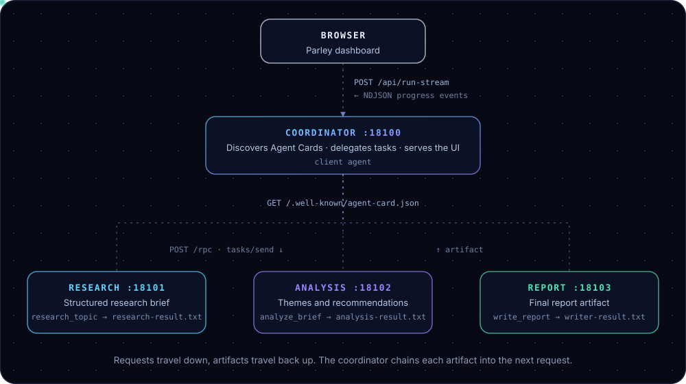
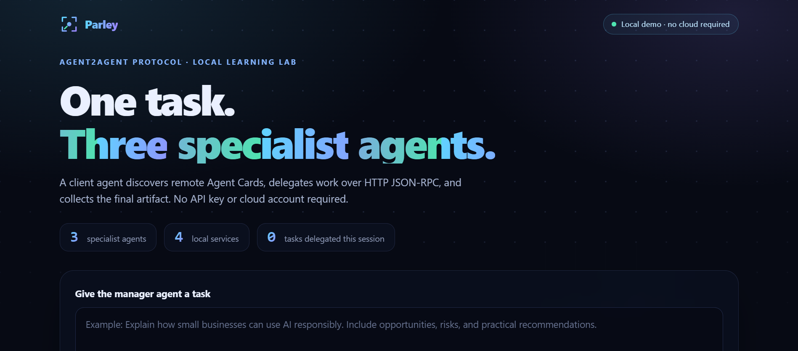

<div align="center">




<br>


<br><br>

<a href="#overview">Overview</a> &nbsp;·&nbsp;
<a href="#screenshots">Screenshots</a> &nbsp;·&nbsp;
<a href="#see-it-in-action">See it</a> &nbsp;·&nbsp;
<a href="#how-it-works">How it works</a> &nbsp;·&nbsp;
<a href="#quick-start">Quick start</a> &nbsp;·&nbsp;
<a href="#the-dashboard">Dashboard</a> &nbsp;·&nbsp;
<a href="#api-reference">API</a> &nbsp;·&nbsp;
<a href="#project-structure">Structure</a> &nbsp;·&nbsp;
<a href="#honest-scope">Scope</a> &nbsp;·&nbsp;
<a href="#contributing">Contribute</a>

</div>


## Overview

**Parley** is a small, local playground for learning how agents hand work to each other. A **coordinator** (the client agent) discovers three **remote agents** through their Agent Cards, sends each one a task over HTTP JSON-RPC, and passes every returned **artifact** to the next agent in the chain. A live dashboard shows each hop as it happens.

Most multi-agent demos hide the interesting part behind an SDK, an API key, or a wall of logs. Parley is built the other way around:

- **You can watch the protocol.** Discovery, `tasks/send`, and artifact hand-offs appear in a live trace, and as glowing packets travelling between nodes.
- **You can read all of it.** The backend is a few hundred lines of Python using only the standard library. The front end is plain HTML, CSS and JavaScript.
- **Nothing to install, nothing to sign up for.** No `pip install`, no npm, no accounts, no network calls.
- **It is honest about what it is.** The agents are deterministic text transformers, not language models. See [Honest scope](#honest-scope).

**Who it is for:** students learning agent-to-agent concepts, developers who want a tiny reference implementation to poke at, and anyone preparing a talk or workshop on the Agent2Agent protocol.

<div align="center">



<sub>Four local services. Requests travel down, artifacts travel back up.</sub>

</div>

> [!NOTE]
> **Pre-release teaching project.** Parley demonstrates the *shape* of an Agent2Agent exchange (roles, Agent Cards, tasks, messages, artifacts). It is not a complete or conformant implementation of the specification.


## Screenshots

<div align="center">



<sub><b>Overview</b>: give the coordinator a task, or pick one of the example chips.</sub>

</div>

<br>

<table>
  <tr>
    <td width="50%" valign="top">
      <br>
      <sub><b>Agent network</b><br>The coordinator connects to each agent. Nodes show their skill, version and port once the Agent Cards are discovered.</sub>
    </td>
    <td width="50%" valign="top">
      <br>
      <sub><b>Run multi-agent workflow</b><br>Each agent moves through its states while the protocol trace and the final report fill in.</sub>
    </td>
  </tr>
</table>


## See it in action

Run a task and the dashboard choreographs the whole exchange:

1. The coordinator **discovers** three Agent Cards and the agent nodes light up with their skill, version and port.
2. A packet rides a grid-routed rail down to the **Research Agent**. Its status mark spins, then draws a check.
3. The returned artifact travels back up, and the coordinator immediately sends it on to the **Analysis Agent**, then the **Report Agent**.
4. The final report is typed into the output panel, with tabs for every intermediate artifact and the raw JSON tasks.

The packets are not decoration: each animation step is driven by a real progress event streamed from the server.

<div align="center">



<sub>The background is a hand-written Canvas 2D engine, not a library. Move the mouse, click, and run a task.</sub>

</div>


## How it works

<div align="center">



</div>

| Step | What happens | Where to read it |
|---|---|---|
| **Discover** | The coordinator fetches `/.well-known/agent-card.json` from each agent: name, description, skill, version and RPC URL. | `client.py` |
| **Delegate** | For each agent in order, it sends a JSON-RPC `tasks/send` request to the agent's `/rpc` endpoint. | `client.py` |
| **Execute** | The agent runs its single skill on the text it received and replies with a completed task. | `agents/server.py` |
| **Chain** | The returned artifact text becomes the input of the next agent. | `client.py` |
| **Stream** | Every state change is emitted as a newline-delimited JSON event to the browser. | `app.py` |
| **Show** | The page turns those events into node states, packets, trace lines and the final report. | `web/app.js` |

The three skills:

| Agent | Port | Skill | Artifact |
|---|---|---|---|
| Research Agent | `18101` | `research_topic`: structured research brief | `research-result.txt` |
| Analysis Agent | `18102` | `analyze_brief`: themes and recommendations | `analysis-result.txt` |
| Report Agent | `18103` | `write_report`: final report | `writer-result.txt` |


## Quick start

**Requirements:** Python 3.10 or newer. That is all.

```bash
# 1. Get the code (any way you like), then enter the folder
cd a2a_demo

# 2. Start all four services
python run.py
```

Or double-click / run the launcher for your OS:

| OS | Command |
|---|---|
| Windows | `start.bat` |
| macOS / Linux | `./start.sh` |

Then open **http://127.0.0.1:18100**, pick an example chip (or type your own task) and press **Run multi-agent workflow**. `Ctrl`+`Enter` works too. Press `Ctrl`+`C` in the terminal to stop everything.

> [!TIP]
> The folder name does not matter. Rename `a2a_demo` to `parley` if you like; nothing depends on it.

**Run the tests**

```bash
python -m unittest discover -s tests -v
```

The suite starts its own services on ports `18200` and up, so it will not collide with a running demo. It covers the full three-agent workflow, empty-input rejection, the browser API, the streaming endpoint, static file serving, and path-traversal protection.

<details>
<summary><b>Troubleshooting</b></summary>

<br>

- **`python` not found.** Install Python 3.10+. On Windows, tick *Add Python to PATH* in the installer. On macOS/Linux use `python3`.
- **Port already in use.** Parley uses `18100` to `18103`. Stop whatever holds them, or change the ports in `run.py` and `client.py`.
- **The page looks unstyled or stale.** Hard-refresh (`Ctrl`+`Shift`+`R`). Assets are served with `Cache-Control: no-store`, so this is rare.
- **The animation is too calm.** If your OS has *reduce motion* enabled, Parley respects it and skips ripples, sparks and packet travel.
- **Nothing happens when I click Run.** Open the browser console. The streaming call is `POST /api/run-stream`; it should return `200` with `application/x-ndjson`.

</details>


## The dashboard

Everything below is hand-written and dependency-free.

| Piece | What it does |
|---|---|
| **Signal grid** (`web/grid.js`) | A Canvas 2D background. Dots swell near the cursor, cells light up as corner brackets with a crosshair and cool off, clicks send a diamond-shaped ripple and a few sparks. Connections between DOM elements are drawn as rails routed along the grid lines, and packets travel along them. |
| **Live agent network** | The coordinator sits above the three agents. Nodes move through *idle, queued, working, done, error* with an animated status mark. |
| **Protocol trace** | Discovery, every `tasks/send`, and every returned artifact, logged with timestamps as they happen. |
| **Artifact tabs** | Final report, each agent's artifact, and the raw JSON task objects. Copy and download buttons included. |
| **Text effects** (`web/fx.js`) | Blur-in headline words, decrypt-style status text, count-up stats, a typewriter for the report, and a cursor-following edge light on panels. |
| **Accessibility** | Semantic landmarks, labelled controls, an ARIA live region for progress, keyboard-operable tabs, visible focus rings, and `prefers-reduced-motion` support. |

The visual ideas were inspired by effect descriptions in the React Bits catalog. All code in this repository was written for this project, and the effects are implemented from scratch.


## API reference

### Coordinator: `http://127.0.0.1:18100`

| Method | Path | Description |
|---|---|---|
| `GET` | `/` | The dashboard. |
| `GET` | `/health` | `{"status": "ok", ...}` |
| `GET` | `/static/*` | Dashboard assets (`.html`, `.css`, `.js`, `.svg`, `.json` only, confined to `web/`). |
| `POST` | `/api/run` | Body `{"topic": "..."}`. Runs the whole workflow and returns one JSON result. |
| `POST` | `/api/run-stream` | Same body. Returns `application/x-ndjson`: one event per line (below). |

**Streaming events**

```jsonc
{"type": "progress", "key": "coordinator", "state": "discovered", "cards": { /* three Agent Cards */ }}
{"type": "progress", "key": "research", "agent": "Research Agent", "state": "running", "description": "..."}
{"type": "progress", "key": "research", "agent": "Research Agent", "state": "completed", "artifact": "research-result.txt"}
// ...the same pair for "analysis" and "writer", then:
{"type": "result", "data": { /* report, per-agent artifacts and raw tasks */ }}
{"type": "error", "message": "..."}   // only if something fails
```

### Each agent: `http://127.0.0.1:1810x`

| Method | Path | Description |
|---|---|---|
| `GET` | `/.well-known/agent-card.json` | The Agent Card. |
| `POST` | `/rpc` | JSON-RPC 2.0. Supports `tasks/send`. |


## Project structure

```text
a2a_demo/
├── run.py                   starts the coordinator and the three agents
├── app.py                   coordinator web server: UI, static files, /api/run, /api/run-stream
├── client.py                discovery and delegation logic (the "client agent")
├── agents/
│   └── server.py            one small JSON-RPC agent server, configured per agent
├── web/
│   ├── index.html           dashboard markup
│   ├── styles.css           theme, glass panels, status marks, button light
│   ├── grid.js              SignalGrid: canvas background, rails and packets
│   ├── fx.js                text and UI effects
│   └── app.js               workflow choreography, trace log, artifact tabs
├── tests/
│   └── test_workflow.py     unittest suite (starts its own services)
├── images/                  README artwork (SVG)
├── start.bat / start.sh     one-step launchers
├── requirements.txt         intentionally empty of packages: stdlib only
├── README.md
└── CONTRIBUTING.md
```

The split is deliberate: `agents/server.py` knows nothing about the UI, `client.py` knows nothing about HTTP serving, and `web/` knows nothing about Python.


## Honest scope

Parley is a **teaching aid**. Please read this before reusing any of it.

- **The agents are not AI.** They apply fixed text rules (split sentences, count words, wrap in a template). The output is a deterministic example, not a researched or fact-checked report.
- **It is a subset of the protocol.** It implements Agent Card discovery and a minimal `tasks/send` JSON-RPC exchange. It does not implement streaming between agents, push notifications, authentication, task cancellation or the full task lifecycle.
- **It is not hardened.** Services bind to `127.0.0.1` and there is no authentication. Do not expose these ports to a network.
- **No license file ships with this source yet.** Add one (MIT, Apache-2.0, or another) before you publish it or accept outside contributions.

## Roadmap

Nothing below is built yet. These are ideas, in no particular order:

- [ ] Optional LLM-backed agents behind a clearly labelled switch (still no key required for the default mode)
- [ ] Task states beyond *completed* (working, input-required, failed) shown in the UI
- [ ] A fourth agent added from the dashboard to demonstrate dynamic discovery
- [ ] Agent-to-agent calls that bypass the coordinator, as a contrast to the current hub design
- [ ] A "replay" mode that plays back a saved run without any services
- [ ] Browser-level UI tests

Ideas and priorities are welcome as issues.

## Contributing

Bug reports, docs, tests, new agents and new effects are all welcome. Start with **[CONTRIBUTING.md](CONTRIBUTING.md)**: it covers setup, a step-by-step guide to adding an agent, the front-end rules, and the originality and safety rules every change must respect.


<div align="center">


<sub>Built to make agent hand-offs visible, not mysterious.</sub>

</div>
